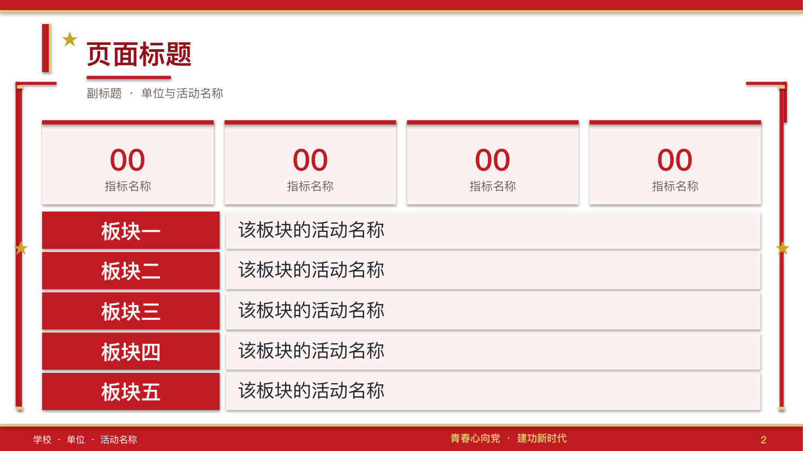
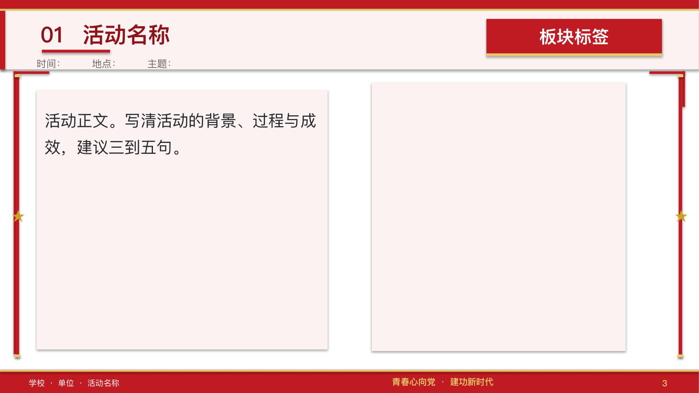
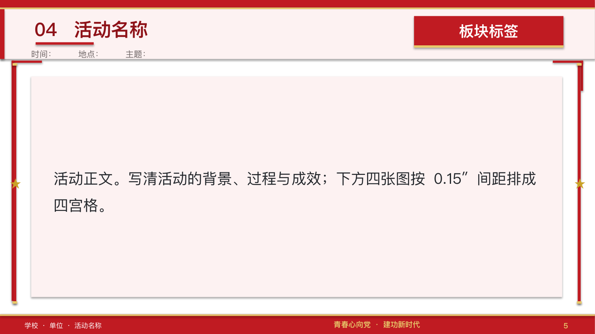
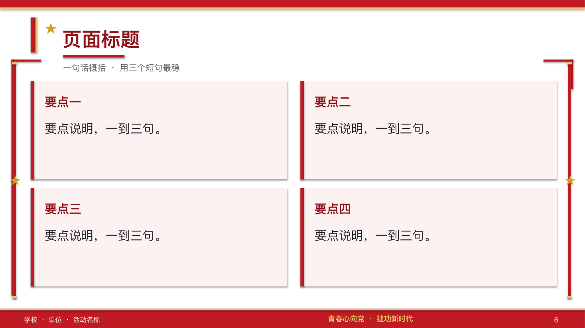
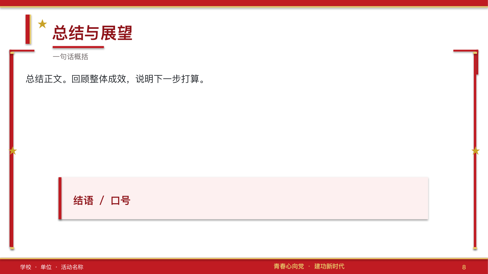

# dangzheng-ppt

**党政风格 PPT 制作 Skill** —— 让 Codex（也兼容 Claude Code 等支持 `SKILL.md` 标准的 Agent）按「中国红 ＋ 金」的党政版式制作和改造中文演示文稿，输出**可编辑的原生 .pptx**。

适用于团日活动、党建、思政、评优与工作汇报类答辩。商务、科技、学术风格不适用。

---

## 安装

### 方式一：让 Agent 自己装（推荐）

把下面这句话原样发给你的 Agent（Codex / Claude Code / Cursor 都行），它会自己克隆到 skills 目录并确认：

```
安装这个 Skill：https://github.com/jiaojiezhiguang/dangzheng-ppt
```

### 方式二：命令行安装

```bash
git clone https://github.com/jiaojiezhiguang/dangzheng-ppt.git ~/.codex/skills/dangzheng-ppt
```

其他 Agent 换掉目标路径即可：

| Agent | 安装目录 |
| --- | --- |
| Codex | `~/.codex/skills/dangzheng-ppt` |
| Claude Code | `~/.claude/skills/dangzheng-ppt` |
| 其他支持开放标准的 Agent | `~/.agents/skills/dangzheng-ppt` |

装完**新开一个会话**，技能清单刷新后即可使用。

> 想跟着上游更新：`cd ~/.codex/skills/dangzheng-ppt && git pull`

---

## 版式预览

下面全部是模板渲染出的**空白版式**（占位文字），可以直接看到每页长什么样。

**封面**


**数据概览**：4 个大数字指标 ＋ 5 行「板块 → 活动」列表



**活动页 · 左文右图列**



**活动页 · 正文 ＋ 四宫格照片**



**亮点页 · 2×2 卡片**



**总结页**



---

## 它解决什么

AI 做党政风 PPT 常踩的坑，这份 skill 把它们变成了可检查的规矩：

- **字体不统一**：只改正文不改主题字体，到 Windows 上会变成中英文两套字体
- **图片被拉伸**、行距不齐、越出页面
- **装饰堆太多**压住正文，或者留白太多显寒酸
- **改稿时覆盖**了用户手改过的版本

---

## 包含什么

```
dangzheng-ppt/
├── SKILL.md                        入口：什么时候用、硬性规范、工作流
├── assets/                         README 用的版式预览图
└── references/
    ├── style-spec.md               精确到 0.01″ 的坐标、色值、字号
    ├── layout-rules.md             图片四条硬规则、文字容量优先级、装饰放置
    ├── toolchain.md                运行时路径、渲染命令、七项验收清单、八个踩过的坑
    └── materials.md                素材库结构，以及「接手前先扫目录找新增」的流程
```

---

## 用法

装好后直接用自然语言提需求：

> 用党政风格做一份团日活动成果汇报 PPT，12 页左右，重点讲志愿服务那块

> 按党政风格把这版 PPT 的装饰重做一遍，底部角标看着像戳到页脚了

> 这页太空了，帮我加点装饰，不要太刻意

---

## 依赖

- **Python 3 ＋ `python-pptx`** —— 改 `.pptx` 用
- **LibreOffice** —— 转 PDF 逐页看版式用；缺了也能做，只是没法渲染核对
- 首次使用时按 `references/toolchain.md` 核对本机路径

---

## 说明

版式规范来自一份真实交付的 28 页答辩 PPT（西安交通大学第四十一届「最佳团日」· 计算机2604团支部），每一条都是从实际被用户打回的反馈里提炼出来的，不是凭空设计的一套模板。

`assets/` 里的预览图是用空白模板渲染的，不含任何真实项目内容。
